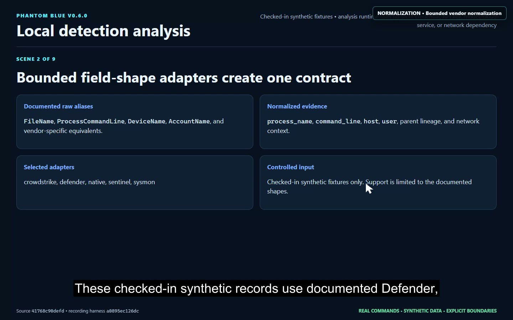
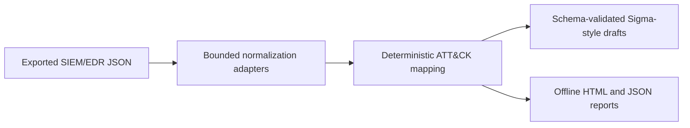

# Phantom Blue

Phantom Blue is an offline Python detection-analysis CLI that normalizes exported SIEM/EDR events, maps conservative MITRE ATT&CK candidates, and produces reviewable Sigma-style draft YAML and HTML reports.

[Watch the recruiter walkthrough](https://samuel-harting-projects.samharting.chatgpt.site/#phantom)

## Verified project evidence

- adapters for ECS/Elastic, Sysmon, Splunk, Defender, Sentinel, and CrowdStrike-shaped JSON
- one documented normalized event contract
- deterministic mappings for 12 ATT&CK techniques
- local schema validation for generated Sigma-style drafts
- explicit negative controls that abstain when evidence is insufficient
- v0.6 verified with 103 automated tests

## Architecture

## Local-only design

Phantom Blue is file-in/report-out by design. It has no hosted dashboard, live SIEM connection, API key, language-model dependency, or network runtime. Inputs in the walkthrough are checked-in synthetic fixtures.

## Source boundary

The complete development repository and release history remain private while they undergo publication review. This public showcase contains sanitized documentation and proof artifacts only.
